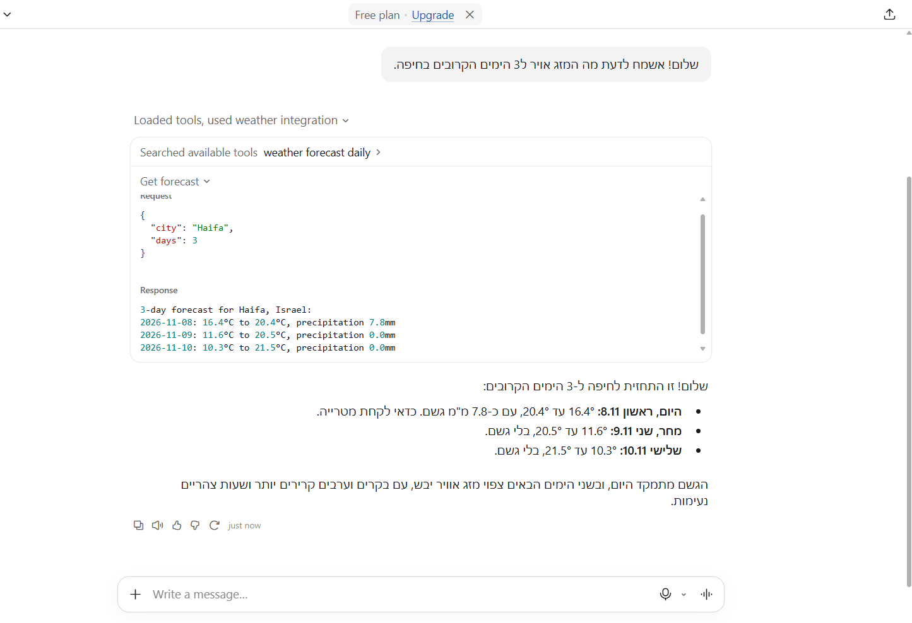
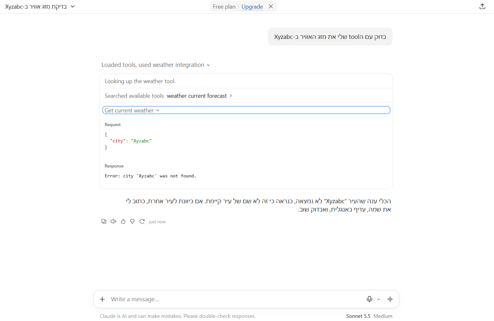

# Weather MCP Server

שרת MCP (Model Context Protocol) בפייתון שנותן למודל שפה, כמו Claude, גישה לנתוני מזג אוויר.
השרת מקבל **שם עיר**, ממיר אותו לקואורדינטות ומחזיר מזג אוויר נוכחי או תחזית יומית.

הנתונים מגיעים מ-[Open-Meteo](https://open-meteo.com/), שירות חינמי שאינו דורש מפתח API.

## כלים (Tools)

| כלי | פרמטרים | תיאור |
|-----|---------|-------|
| `get_current_weather` | `city: str` | טמפרטורה, לחות ומהירות רוח נוכחיות בעיר |
| `get_forecast` | `city: str`, `days: int = 3` | תחזית יומית (טמפרטורה מינימלית ומקסימלית, משקעים) ל-1 עד 16 ימים |

### דוגמת פלט

```
Current weather in Tel Aviv, Israel:
Temperature: 17.9°C
Humidity: 66%
Wind speed: 6.3km/h
```

```
3-day forecast for Tel Aviv, Israel:
2026-11-09: 16.0°C to 22.0°C, precipitation 1.2mm
2026-11-10: 14.0°C to 21.0°C, precipitation 0.0mm
2026-11-11: 15.0°C to 23.0°C, precipitation 0.0mm
```

> מומלץ לכתוב שמות ערים באנגלית (למשל `Tel Aviv`, `Rishon LeZion`), כי שירות ההמרה לקואורדינטות עובד איתם בצורה יציבה יותר.

## דרישות

- Python 3.10 ומעלה
- חיבור לאינטרנט
- החבילות: `mcp`, `httpx`, `truststore`
- לבדיקות: `pytest`, `respx`

## התקנה

```bash
# יצירת סביבה וירטואלית והפעלתה
python -m venv .venv
.venv\Scripts\activate          # Windows
# source .venv/bin/activate     # macOS / Linux

# התקנת התלויות
pip install "mcp[cli]>=2,<3" httpx truststore
```


## הרצה

```bash
python server.py
```

השרת משתמש בתקשורת `stdio`, ולכן הוא ימתין בשקט להודעות מלקוח. זה המצב התקין.

### בדיקה עם MCP Inspector

כלי גרפי להפעלת הכלים ידנית:

```bash
npx @modelcontextprotocol/inspector python server.py
```

(דורש Node.js.)

## חיבור ל-Claude Desktop

1. ב-Claude Desktop: **Settings**, ואז **Developer**, ואז **Edit Config**.
2. מוסיפים את הבלוק הבא **ברמה העליונה** של קובץ `claude_desktop_config.json`:

```json
{
  "mcpServers": {
    "weather": {
      "command": "C:/path/to/project/.venv/Scripts/python.exe",
      "args": ["C:/path/to/project/server.py"]
    }
  }
}
```

3. חשוב:
   - להשתמש בנתיבים **מלאים**.
   - `command` צריך להצביע על ה-`python.exe` של **הסביבה הווירטואלית** של הפרויקט.
   - ב-`args` רק הנתיב לקובץ השרת.
   - אם בקובץ כבר יש תוכן, מוסיפים את `mcpServers` כמפתח נוסף (עם פסיק), ולא מוחקים את הקיים.
4. לסגור את Claude Desktop לגמרי (גם מאזור ההתראות) ולפתוח מחדש.
5. בשיחה חדשה אפשר לבקש, למשל:
   > השתמש בכלי get_current_weather מהשרת weather שלי ובדוק את מזג האוויר ב-Tel Aviv

> **שימו לב:** ל-Claude יש גם כלי מזג אוויר מובנה, ולפעמים הוא נבחר לפני הכלי של השרת. כדי לוודא שהשרת שלנו נקרא, מציינים בבקשה את שם הכלי או "השרת weather שלי".

### צילומי מסך





## טיפול בשגיאות

הכלים מחזירים הודעות שגיאה קריאות ולא קורסים:

| מצב | התנהגות |
|-----|---------|
| שם עיר ריק | `Error: city name is empty.` |
| עיר לא נמצאה | `Error: city '<name>' was not found.` |
| `days` מחוץ לטווח 1 עד 16 | `Error: days must be between 1 and 16.` |
| timeout | `Error: the weather service did not respond in time.` |
| שגיאת רשת או HTTP | `Error: failed to reach the weather service (...)` |
| תשובה ריקה מה-API | `Error: the weather service returned no data.` |

## בדיקות

```bash
pip install pytest respx
pytest -v
```

הבדיקות מחליפות את הקריאות לרשת באמצעות `respx`, ולכן הן רצות ללא חיבור לאינטרנט.
הן מכסות את המרת שם העיר, הצלחה, עיר לא קיימת, timeout, שגיאות HTTP, ואימות הקלט של `get_forecast`.

## מבנה הפרויקט

```
.
├── server.py        # שרת ה-MCP והכלים
├── test_server.py   # בדיקות pytest
└── README.md
```

## הערות טכניות

- **פונקציית עזר משותפת:** `fetch_weather` מבצעת את ההמרה משם עיר לקואורדינטות ואת שליפת הנתונים עבור שני הכלים, ומשתמשת ב-`WeatherError` לשגיאות עם הודעה קריאה.
- **תעודות SSL:** הפרויקט משתמש ב-`truststore` כדי שפייתון יסתמך על התעודות של מערכת ההפעלה. זה פותר שגיאת `CERTIFICATE_VERIFY_FAILED` ברשתות עם סינון או בדיקת SSL.
- **stdout:** שרת `stdio` אינו כותב ל-stdout דברים מיותרים, כי זה פוגע בתקשורת. לדיבוג משתמשים ב-`print(..., file=sys.stderr)` או ב-`logging`.
- **מגבלה ידועה:** ההמרה לקואורדינטות מחזירה את ההתאמה הראשונה בלבד, ולכן שמות עמומים (כמו Haifa או Springfield) עלולים להתאים למקום אחר מהמצופה.

## הרחבות אפשריות

- פרמטר `country` להבחנה בין ערים עם אותו שם
- מטמון לתוצאות ההמרה לקואורדינטות
- בחירת יחידות מדידה (צלזיוס או פרנהייט)
- `resource` של MCP שמחזיר רשימת ערים נתמכות

## קרדיט

נתוני מזג האוויר: [Open-Meteo.com](https://open-meteo.com/).